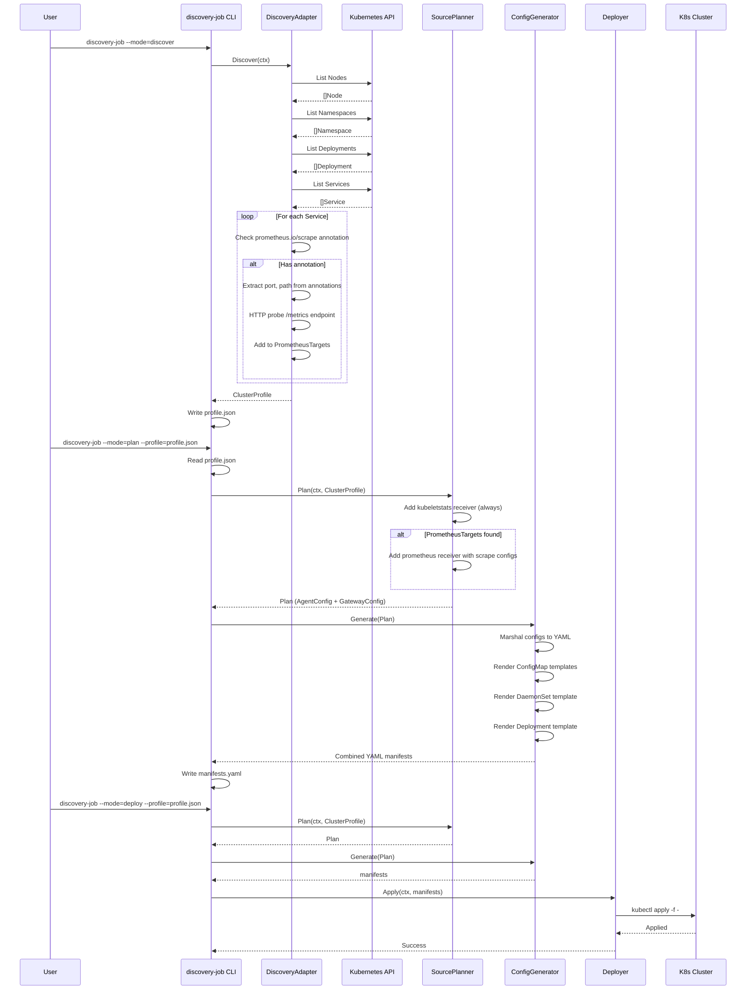

# Discovery Flow

This document describes the discovery-driven OTel collection pipeline implemented in Phase 2.

## Sequence Diagram



## Pipeline Stages

### 1. Discovery (`--mode=discover`)

The discovery adapter queries the Kubernetes API and produces a `ClusterProfile`:

```go
type ClusterProfile struct {
    ClusterID            entities.EntityID
    DiscoveredAt         time.Time
    Nodes                []entities.Node
    Namespaces           []entities.Namespace
    Workloads            []entities.Workload
    Services             []entities.Service
    Sources              []ObservabilitySource
    CollectionPaths      []OTelCollectionPath
    RecommendedReceivers []string
}
```

**Prometheus Detection Logic:**

1. Iterate through all services in the cluster
2. Check for `prometheus.io/scrape: "true"` annotation
3. Extract metrics path from `prometheus.io/path` (default: `/metrics`)
4. Extract port from `prometheus.io/port` (default: first service port)
5. Optionally probe the endpoint to verify reachability

### 2. Planning (`--mode=plan`)

The source planner reads the `ClusterProfile` and generates OTel Collector configurations:

**Agent Configuration (always includes):**
- `kubeletstats` receiver for node/pod/container metrics

**Agent Configuration (conditional):**
- `prometheus` receiver with scrape configs for each discovered target

**Gateway Configuration:**
- `otlp` receiver (gRPC) for agent data
- `batch` processor
- `debug` exporter (for testing)

### 3. Config Generation

The generator renders Kubernetes manifests from the plan:

1. **ConfigMap** for agent collector config
2. **ConfigMap** for gateway collector config
3. **DaemonSet** for agent collectors
4. **Deployment** for gateway collector

### 4. Deployment (`--mode=deploy`)

The deployer applies the generated manifests using `kubectl apply -f -`.

## Example Output

### ClusterProfile (Prometheus Available)

```json
{
  "cluster_id": "cluster:kind-test",
  "discovered_at": "2026-03-13T10:00:00Z",
  "nodes": [{"id": "node:kind-test:kind-control-plane"}],
  "namespaces": [{"id": "namespace:kind-test:oksg-demo"}],
  "workloads": [
    {"id": "workload:kind-test:oksg-demo:gateway-go:deployment"}
  ],
  "services": [
    {"id": "service:kind-test:oksg-demo:gateway-go"}
  ],
  "sources": [
    {
      "name": "application-prometheus",
      "type": "prometheus",
      "present": true,
      "prometheus_targets": [
        {
          "service_name": "gateway-go",
          "namespace": "oksg-demo",
          "port": 8080,
          "path": "/metrics",
          "reachable": true
        }
      ]
    }
  ],
  "collection_paths": [
    {"receiver_type": "kubeletstats", "enabled": true},
    {"receiver_type": "prometheus", "enabled": true, "targets": ["oksg-demo/gateway-go:8080/metrics"]}
  ],
  "recommended_receivers": ["kubeletstats", "prometheus"]
}
```

### ClusterProfile (No Telemetry Fallback)

```json
{
  "cluster_id": "cluster:kind-test",
  "discovered_at": "2026-03-13T10:00:00Z",
  "sources": [
    {
      "name": "application-prometheus",
      "type": "prometheus",
      "present": false,
      "prometheus_targets": []
    }
  ],
  "collection_paths": [
    {"receiver_type": "kubeletstats", "enabled": true}
  ],
  "recommended_receivers": ["kubeletstats"]
}
```

## CLI Usage

```bash
# Run discovery and save profile
./discovery-job --mode=discover --kubeconfig=$HOME/.kube/config --output=profile.json

# Generate manifests from profile
./discovery-job --mode=plan --profile=profile.json --output=manifests.yaml

# Deploy collectors (plan + apply in one step)
./discovery-job --mode=deploy --profile=profile.json --namespace=oksg-system
```
