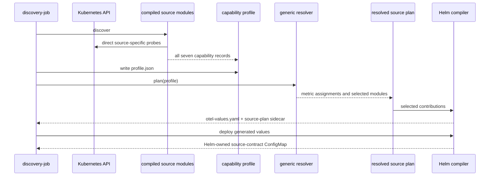

# Discovery and source planning

Discovery produces a capability-only snapshot. It does not serialize cluster
topology or collector recommendations. Live Kubernetes topology is owned by
the `kubernetes.structure` module at backend runtime.

## Capability profile

The profile contains cluster identity, discovery time, and exactly one record
for every compiled module:

- `kubernetes.structure` (non-metric)
- `kubelet`, `host-os`, `kube-cluster`
- `prometheus.app`, `mesh.istio`, `traces.servicegraph`

Each record has a stable source ID, `direct` or `derived` kind, availability
status, signal classes, and bounded evidence. The profile records unavailable
modules too, so it is an auditable result of successful detection rather than
a list of only positive findings.

`traces.servicegraph` is derived: its evidence identifies a discovered
trace-capable OTLP producer, while the selected gateway connector produces the
metric source.

Detector API failures fail discovery. They are never interpreted as an absent
source. Mesh detection is `partial` when its injection/proxy requirements are
not complete and is therefore not eligible for metric arbitration.

## Source planning

The metric catalog declares eligible sources and priority. The generic resolver
uses only available capability records to select at most one source for each
canonical metric. There are no operator source overrides.

The resulting sidecar is written beside `--values-output` as
`<values-output>.source-plan.json` unless `--resolved-plan-output` is given.
It includes:

- a fingerprint of the normalized capability profile;
- selected source module IDs;
- the complete canonical metric-to-source assignment.

The compiler consumes the same result to include only selected receiver,
connector, scrape, pipeline, and source-stamp fragments. Generated values also
carry the capability profile and resolved plan under `backend.sourceContract`.
Helm renders both into one release-scoped `*-source-contract` ConfigMap and
mounts it in the backend. Normal deployment has no imperative ConfigMap apply
or rollout-restart step.

## Runtime contract

Backend startup requires both mounted files. It recomputes the profile
fingerprint, rejects a mismatch, verifies the full static capability inventory,
and validates the plan as the exact catalog projection: no unknown, missing,
or extra metrics; only selected, available telemetry sources; and no
assignment to an unselected source. It uses that mounted assignment for
ingestion policy and never resolves sources again at runtime.

The backend independently creates an in-cluster Kubernetes client for
`kubernetes.structure`. That module refreshes the canonical structural graph
at startup and on `OKSG_STRUCTURE_REFRESH_INTERVAL`; the interval must be
positive and strictly shorter than `OKSG_NODE_TTL` whenever TTL is enabled.
