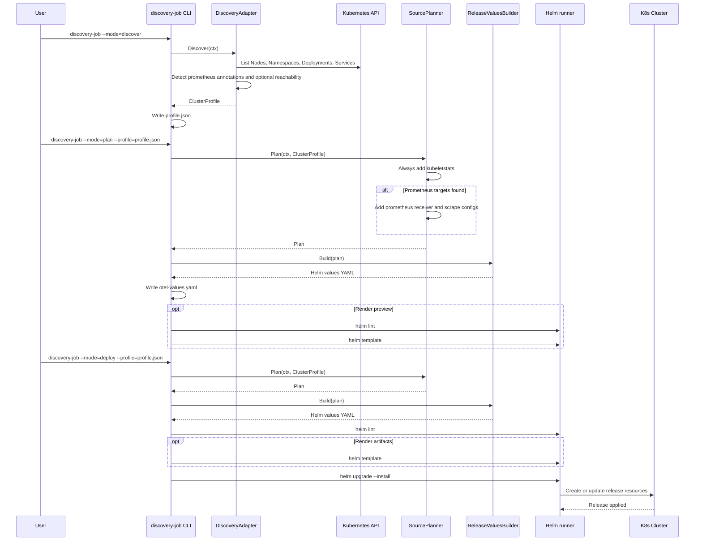

# Discovery Flow

This document describes the currently implemented discovery-driven collector flow.

## Sequence Diagram



## Pipeline Stages

### 1. Discovery

The discovery adapter queries Kubernetes and produces a `ClusterProfile` with:

- cluster ID
- discovered nodes, namespaces, workloads, and services
- detected observability sources
- recommended collection paths and receivers

Prometheus detection is currently based on service annotations:

- `prometheus.io/scrape`
- `prometheus.io/path`
- `prometheus.io/port`

### 2. Source Planning

The source planner turns the profile into collector intent:

- agent always includes `kubeletstats`
- agent adds `prometheus` only when targets were discovered
- gateway receives OTLP from agents
- collector telemetry logging is configured for JSON stdout logging with env-controlled level

### 3. Release Values Generation

The values builder converts the plan into typed Helm values instead of final Kubernetes manifests.

Those values contain:

- global release and image settings
- agent and gateway collector configs
- per-component logging levels
- rollout settings such as config checksum enablement

### 4. Helm Deployment

The deployer now performs:

1. `helm lint`
2. optional `helm template`
3. `helm upgrade --install`

The Helm chart is responsible for:

- ConfigMaps
- ServiceAccounts and RBAC
- agent DaemonSet
- gateway Service and Deployment
- restart-on-config-change annotations

## Example Output

### ClusterProfile (Prometheus Available)

```json
{
  "cluster_id": "cluster:kind-test",
  "discovered_at": "2026-03-13T10:00:00Z",
  "nodes": [{"id": "node:kind-test:kind-control-plane"}],
  "namespaces": [{"id": "namespace:kind-test:oksg-demo"}],
  "workloads": [
    {"id": "workload:kind-test:oksg-demo:gateway-go:deployment"}
  ],
  "services": [
    {"id": "service:kind-test:oksg-demo:gateway-go"}
  ],
  "sources": [
    {
      "name": "application-prometheus",
      "type": "prometheus",
      "present": true,
      "prometheus_targets": [
        {
          "service_name": "gateway-go",
          "namespace": "oksg-demo",
          "port": 8080,
          "path": "/metrics",
          "reachable": true
        }
      ]
    }
  ],
  "collection_paths": [
    {"receiver_type": "kubeletstats", "enabled": true},
    {"receiver_type": "prometheus", "enabled": true, "targets": ["oksg-demo/gateway-go:8080/metrics"]}
  ],
  "recommended_receivers": ["kubeletstats", "prometheus"]
}
```

### ClusterProfile (No Telemetry Fallback)

```json
{
  "cluster_id": "cluster:kind-test",
  "discovered_at": "2026-03-13T10:00:00Z",
  "sources": [
    {
      "name": "application-prometheus",
      "type": "prometheus",
      "present": false,
      "prometheus_targets": []
    }
  ],
  "collection_paths": [
    {"receiver_type": "kubeletstats", "enabled": true}
  ],
  "recommended_receivers": ["kubeletstats"]
}
```

## CLI Usage

```bash
# Run discovery and save profile
./discovery-job --mode=discover --kubeconfig=$HOME/.kube/config --output=profile.json

# Generate Helm values from profile
./discovery-job --mode=plan --profile=profile.json --values-output=otel-values.yaml

# Render chart output for inspection
./discovery-job --mode=plan --profile=profile.json --values-output=otel-values.yaml --rendered-output=./bin/e2e/rendered

# Deploy collectors through Helm
./discovery-job --mode=deploy --profile=profile.json --namespace=oksg-system --release-name=oksg-otel --chart-path=./deploy/helm/oksg-otel
```
