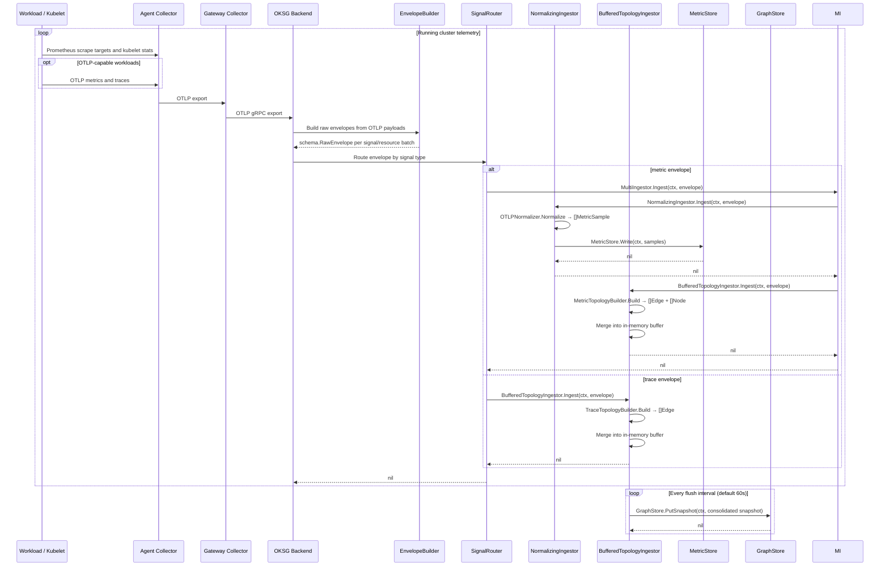
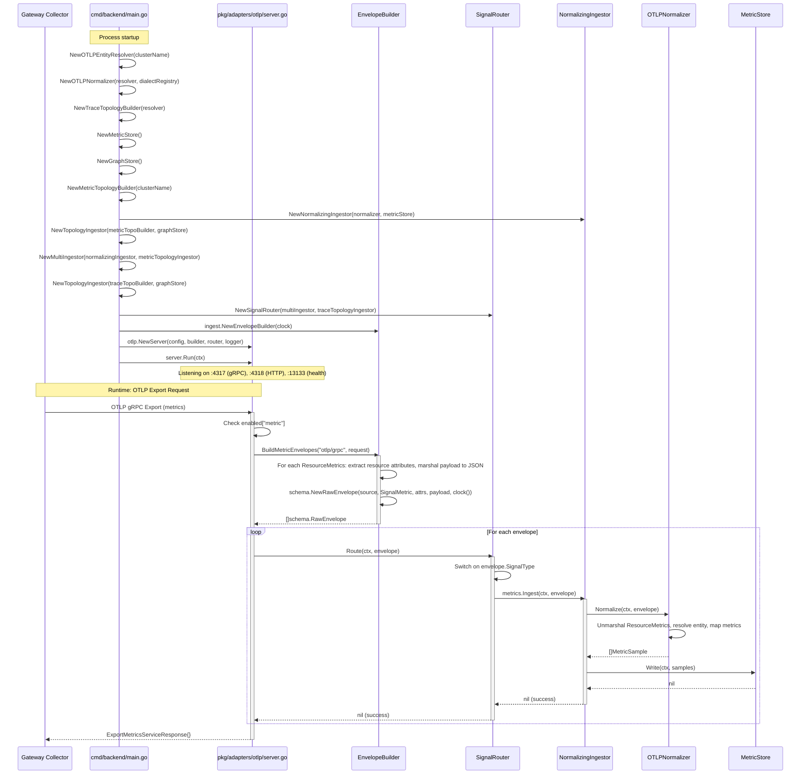

# Runtime Flow

What happens after the OTel collection plane is deployed: agent collection,
gateway forwarding, backend OTLP ingest, normalization, and topology
accumulation. For the discover/plan/deploy upstream of this, see
[`discovery-flow.md`](./discovery-flow.md). For the metrics catalog /
dialect / source arbitration, see [`metrics-pipeline.md`](./metrics-pipeline.md).

## Sequence Diagram



## Backend Ingest Sequence

The following diagram shows how the backend process wires and runs its components, and how a single OTLP request flows through them.



## Component Responsibilities

| File | Type | Role |
|------|------|------|
| `cmd/backend/main.go` | Binary entrypoint | Parses config (including `--cluster-name`), wires normalization pipeline, starts server |
| `pkg/adapters/otlp/server.go` | `Server` | OTLP gRPC/HTTP listener, delegates to builder + router |
| `pkg/backend/ingest/otlp.go` | `EnvelopeBuilder` | Converts OTLP protos → `[]schema.RawEnvelope` |
| `pkg/backend/ingest/otlp.go` | `SignalRouter` | Routes envelopes by signal type to the right `Ingestor` |
| `pkg/backend/ingest/entity_resolver.go` | `OTLPEntityResolver` | Maps OTLP resource attributes to canonical `EntityID` (deterministic SHA-256) |
| `pkg/backend/ingest/normalizer.go` | `OTLPNormalizer` | Maps OTLP metric payloads to canonical `MetricSample` values with unit conversion |
| `pkg/backend/ingest/topology_builder.go` | `TraceTopologyBuilder` | Extracts service-to-service `topology.Edge` values from OTLP trace envelopes |
| `pkg/backend/ingest/normalizing_ingestor.go` | `NormalizingIngestor` | Implements `Ingestor`; routes metric envelopes through normalizer → `MetricStore` |
| `pkg/backend/ingest/buffered_topology_ingestor.go` | `BufferedTopologyIngestor` | Implements `Ingestor`; accumulates edges/nodes from metric and trace builders, flushes consolidated snapshots to `GraphStore` on a timer |
| `pkg/backend/ingest/normalizing_ingestor.go` | `MultiIngestor` | Implements `Ingestor`; fans envelopes to multiple downstream ingestors in order |
| `pkg/backend/ingest/metric_topology_builder.go` | `MetricTopologyBuilder` | Extracts structural `runs_on`/`contains` edges and nodes from metric resource attributes |
| `pkg/backend/ingest/mesh_metric_topology_builder.go` | `MeshMetricTopologyBuilder` | Derives `calls` edges from servicegraph-shaped mesh metrics with `mesh.istio` provenance |
| `pkg/backend/ingest/composite_topology_builder.go` | `CompositeTopologyBuilder` | Chains topology builders so the metric path runs structural + mesh builders together |
| `pkg/backend/ingest/structural_topology_builder.go` | `K8sStructuralTopologyBuilder` | Derives `exposes`/`routes_to`/`uses`/`mounts` edges from ClusterProfile |
| `pkg/backend/ingest/structural_topology_ingestor.go` | `StructuralTopologyIngestor` | Ingests K8s structural topology from ClusterProfile into GraphStore |
| `pkg/core/metrics/{catalog,sources,dialect,resolver}.go` | Metrics pipeline | Catalog, source registry, dialect translation, and priority-based source arbitration |
| `pkg/core/semconv/keys.go` | Attribute keys | OTLP semantic-convention attribute key constants shared across ingest and topology |
| `pkg/backend/persistence/memory.go` | `MetricStore` | Thread-safe in-memory `MetricStore`; supports write and time-range queries |
| `pkg/backend/persistence/memory.go` | `GraphStore` | Thread-safe in-memory `GraphStore`; accumulates edges and nodes, updates `LastSeen` on re-observation |
| `pkg/adapters/storage/victoriametrics/` | `VMMetricStore` | `MetricStore` backed by VictoriaMetrics HTTP API (Prometheus text import + PromQL query) |
| `pkg/adapters/storage/postgresql/` | `PostgresGraphStore` | `GraphStore` backed by PostgreSQL with accumulated edge upserts |
| `pkg/adapters/storage/factory.go` | `Stores` / `NewStores` | Factory that wires memory or external (PG+VM) backends based on config |
| `pkg/backend/ingest/ingest.go` | `Ingestor` interface | Contract: `Ingest(ctx, envelope) error` |
| `pkg/core/schema` | `RawEnvelope` | Canonical telemetry envelope struct |

## Data Flow Summary

```
Gateway
   │
   │ OTLP gRPC/HTTP
   ▼
┌──────────────────────────────────────────────────────────────┐
│  pkg/adapters/otlp/server.go                                 │
│  (metricsService.Export / handleMetricsHTTP)                 │
│                                                              │
│  1. Check signal enabled                                     │
│  2. builder.BuildMetricEnvelopes("otlp/grpc", request)       │
│  3. for each envelope: router.Route(ctx, envelope)           │
└──────────────────────────────────────────────────────────────┘
         │                              │
         │ BuildMetricEnvelopes         │ Route
         ▼                              ▼
┌─────────────────────────┐   ┌─────────────────────────────────────────────────┐
│ EnvelopeBuilder         │   │ SignalRouter                                    │
│ (pkg/backend/ingest)    │   │ (pkg/backend/ingest)                            │
│                         │   │                                                 │
│ → []schema.RawEnvelope  │   │ metric → MultiIngestor                          │
└─────────────────────────┘   │ trace  → BufferedTopologyIngestor               │
                              └─────────────────────────────────────────────────┘
                                        │                          │
                              ┌─────────▼──────────┐   ┌──────────▼──────────────────────────┐
                              │ MultiIngestor      │   │ BufferedTopologyIngestor (shared)   │
                              │                    │   │  metric + trace paths → buffer      │
                              │ ┌─────────────────┐│   │  periodic flush → GraphStore        │
                              │ │NormalizingIngest││   └──────────────────────────────────────┘
                              │ │ OTLPNormalizer  ││                │
                              │ │ → []MetricSample││                ▼
                              │ │ MetricStore     ││   ┌─────────────────────┐
                              │ └─────────────────┘│   │ GraphStore          │
                              │ ┌─────────────────┐│   │ (nodes + edges)     │
                              │ │BufferedTopology ││   │ (pkg/backend/       │
                              │ │Ingestor (shared)││   │  persistence)       │
                              │ │ → []Edge + Node ││   └─────────────────────┘
                              │ │ → in-memory buf ││
                              │ └─────────────────┘│
                              └────────────────────┘
                                        │
                                        ▼
                              ┌─────────────────────┐
                              │ MetricStore         │
                              │ (pkg/backend/       │
                              │  persistence)       │
                              └─────────────────────┘
```

## Runtime Stages

### 1. Agent Collection

The agent collector is the node-local collection entrypoint.

What it does today:

- always collects infrastructure telemetry with `kubeletstats`
- adds `prometheus` scraping when discovery found annotated services
- enables `otlp` receivers when discovery found OTLP-capable sources
- enriches metrics and traces with `k8sattributes`
- batches data before export
- exports to the in-cluster gateway over OTLP gRPC

Operational notes:

- the agent is deployed as a DaemonSet
- startup retries against the gateway are expected if the gateway pod is not ready yet
- the current chart enables the `receiver.kubeletstats.enableCPUUsageMetrics` feature gate to align with the collector's newer kubelet CPU metric behavior

### 2. Gateway Routing

The gateway collector is the shared in-cluster fan-in point.

What it does today:

- receives OTLP over gRPC and HTTP
- accepts exports from the agent
- can also accept OTLP-native application telemetry
- collects Kubernetes API-backed metrics with `k8s_cluster`, including workload/controller counts, HPA replicas, ResourceQuota usage, pod phases, node conditions, and node allocatable resources; structural discovery emits matching graph nodes for those controller, HPA, and ResourceQuota entity IDs
- applies `memory_limiter` and `batch`
- exports to the backend OTLP gRPC endpoint
- uses send-queue and retry settings for basic transport resilience

Operational notes:

- the gateway is deployed as a single Deployment replica
- its job is collection and forwarding only; it does not perform semantic normalization or persistence

### 3. Backend OTLP Ingest

The OKSG backend is the OKSG-owned runtime that accepts forwarded telemetry and drives the normalization pipeline.

What it does today:

- listens for OTLP gRPC on port `4317`
- listens for OTLP HTTP on port `4318`
- serves health checks on port `13133`
- serves the REST API on port `8080`
- accepts enabled signal classes from the deployed plan
- parses incoming OTLP metrics and traces
- hands accepted payloads to the normalization pipeline

The `--cluster-name` flag (or `OKSG_CLUSTER_NAME` env var) controls the cluster name used for entity ID computation. It defaults to `default`.

Operational notes:

- logs are structured JSON to stdout
- with `--storage-backend=memory` (default), data survives only for the process lifetime
- with `--storage-backend=external`, data is persisted to PostgreSQL (graph, entities, metadata) and VictoriaMetrics (metrics)

### Metric Normalization Semantics

The backend serves a scalar metrics API, so OTLP metrics are normalized into canonical samples before storage and query:

- Gauge and Sum datapoints are copied as scalar samples, then multiplied by the configured conversion factor.
- Histogram datapoints are normalized as average values using `sum / count`. Datapoints with `count == 0` are skipped.
- Servicegraph-derived metrics preserve `edge_client`, `edge_server`, `edge_client_id`, and `edge_server_id` labels so edge queries can join runtime telemetry back onto topology edges.
- Pod-volume metrics preserve selected topology labels such as `k8s.volume.name`, `k8s.persistentvolumeclaim.name`, `k8s.pod.name`, and `k8s.namespace.name`. When a volume datapoint carries a resolvable PVC identity, the normalizer stores the sample against the PVC entity. Otherwise it remains pod-scoped, and topology cards must not render PVC storage from that sample.

### Request, Error, and Duration Semantics

The semconv names stay stable across storage and the API, but the semantics still come from the upstream emitters:

- `traces.span.metrics.calls` translates to `rpc.server.request.count`, then the API serves it as `rate(rpc.server.request.count[1m])`.
- `traces.service.graph.request.total` translates to `servicegraph.request.count`, then the API serves it as `rate(servicegraph.request.count[1m])`.
- `traces.service.graph.request_failed_total` translates to `servicegraph.request.error.count`, then the API serves it as `rate(servicegraph.request.error.count[1m])`.
- `servicegraph.request.error.ratio` is not stored directly; the API derives it at query time as `rate(servicegraph.request.error.count[1m]) / clamp_min(rate(servicegraph.request.count[1m]), 1e-9)`.
- `http_request_duration_seconds` translates to `http.server.request.duration` and is normalized from seconds to nanoseconds.
- `traces.span.metrics.duration` translates to `rpc.server.duration` and is normalized from milliseconds to nanoseconds unless the collector configuration is explicitly changed to export seconds.
- `traces.service.graph.request.server` translates to `servicegraph.request.duration` and is normalized from seconds to nanoseconds.

The fixed query window for request and error rates is currently 1 minute.

### 4. Raw Envelope Build

After the backend receives OTLP payloads, `pkg/backend/ingest` converts them into canonical raw envelopes.

What the envelope builder currently captures:

- signal type such as `metric` or `trace`
- source transport such as `otlp/grpc` or `otlp/http`
- receive timestamp
- resource attributes attached to the OTLP payload
- raw payload bytes for later downstream processing

This is the current canonical handoff from collection into future semantic processing layers.

### 5. Signal Routing

The backend routes each `schema.RawEnvelope` by signal type.

What is implemented today:

- metric envelopes are routed to `NormalizingIngestor`
- trace envelopes are routed to `TopologyIngestor` when the signal is enabled
- routing happens through explicit ingest interfaces in `pkg/backend/ingest`

### 6. Semantic Normalization and Persistence

After routing, envelopes are normalized into canonical domain objects.

Metric path:

- `OTLPEntityResolver` maps OTLP resource attributes to a canonical `EntityID` (deterministic SHA-256 of kind + cluster + attributes). Resolution priority: container > pod > node > deployment > statefulset > replicaset > daemonset > namespace > service. Volume metrics with a PVC label use the PVC identity before the generic resource fallback. Entity resolution errors fail the envelope.
- `OTLPNormalizer` first translates source dialects into semconv-style metric names, then maps each recognized OTLP metric name to a semconv-native `MetricSample` using the registered `OTLPSemconvMetrics`. Applies unit conversion. Resolves directional names for disk, network, and node condition metrics. Servicegraph connector and Istio mesh metrics are enriched with `edge_client`/`edge_server` labels and stable `edge_client_id`/`edge_server_id` labels derived from canonical service entity IDs. Istio request-duration histograms are converted from milliseconds to nanoseconds, histograms are stored as `_sum`/`_count`, and `servicegraph.request.error.ratio` remains query-derived. Unrecognized metric names are silently skipped.
- `MetricStore` stores the resulting samples in memory. Supports time-range, entity-filtered, and edge-filtered queries.
- `MetricTopologyBuilder` extracts structural topology from resource attributes (no payload parsing). It derives `runs_on` edges (pod→node), `contains` edges (namespace→pod, pod→container), and the corresponding `topology.Node` values for all resolved entity kinds. `MeshMetricTopologyBuilder` parses servicegraph-shaped mesh metrics and emits `calls` edges with `mesh.istio` provenance plus protocol, mTLS, principal, and response metadata. Mesh `calls` edges take `FirstSeen`/`LastSeen` from the metric datapoint timestamp, falling back to the envelope timestamp only when the datapoint has no timestamp.
- `GraphStore` accumulates edges and nodes across snapshots. Re-observed edges have their `LastSeen` updated; nodes are merged by entity ID.

Trace path:

- `TraceTopologyBuilder` scans each span for a `peer.service` attribute. When found, it resolves both caller and callee to `EntityID` values and emits a `topology.Edge` with `RelCalls` relation. Edges are deduplicated within the batch by edge ID. `FirstSeen`/`LastSeen` are taken from span timestamps.
- `GraphStore` accumulates edges and nodes; trace-derived `calls` edges accumulate alongside structural edges from the metric path.

### 7. Source-Mismatch Drop

When a discovery profile is loaded at backend startup, `cmd/backend/main.go` calls `metrics.Resolve(catalog, registry, profile)` to compute the canonical-to-source `Assignment` and passes it to the normalizer via `WithAssignment(...)`.

For each incoming datapoint, after dialect translation and directional name resolution, the normalizer compares the sample's `oksg_source` attribute (stamped by the agent/gateway `transform/oksg-source` processor, by application Prometheus scrape relabeling, or by Istio's Prometheus relabel rule) against `Assignment[canonical]`. If the canonical metric has an assigned source and the sample's source disagrees, the sample is dropped and the `dropped` counter — an `atomic.Uint64` to remain safe under the OTLP server's concurrent request handling — is incremented. Samples without an `oksg_source` attribute follow a legacy accept path so envelopes from external producers aren't silently dropped.

The cumulative drop count is exposed via `OTLPNormalizer.DroppedSampleCount()`. See [metrics-pipeline.md](metrics-pipeline.md) for the catalog/registry/resolver contract.

## Runtime View

```text
Workloads / Kubelet
        |
        v
Agent Collector
  - kubeletstats (pod, container, volume)
  - hostmetrics (CPU, memory, disk, network, load)
  - prometheus (when discovered)
  - otlp (when discovered)
        |
        v
Gateway Collector
  - otlp receive
  - k8s_cluster (workloads, jobs, HPAs, quotas, pod phases, node conditions)
  - spanmetrics connector (when OTLP traces present)
  - servicegraph connector (when OTLP traces present)
  - memory_limiter
  - batch
        |
        v
OKSG Backend
  - OTLP gRPC/HTTP ingest
  - Raw envelope build
  - Signal routing
    ├── metric → MultiIngestor
    │     ├── NormalizingIngestor → OTLPNormalizer → MetricStore
    │     └── BufferedTopologyIngestor (shared) → accumulates edges + nodes
    │           edges: runs_on (pod→node), contains (ns→pod, pod→container)
    │           nodes: namespace, node, pod, container
    └── trace → BufferedTopologyIngestor (shared) → accumulates edges + nodes
          edges: calls (service→service via peer.service attribute)
  - Periodic topology flush (default 60s)
    └── BufferedTopologyIngestor → GraphStore.PutSnapshot(consolidated snapshot)
  - Structural topology (at startup, if --discovery-profile provided)
    └── StructuralTopologyIngestor(K8sStructuralTopologyBuilder) → GraphStore
          edges: exposes (service→workload), routes_to (ingress→service),
                 uses (workload→configmap/secret), mounts (workload→pvc),
                 contains (workload→pod when discovery can resolve ownership)
          nodes: workload, service, ingress, configmap, secret, pvc, pod

REST API Server (:8080) — all list endpoints support cursor-based pagination
  - /api/v1/status         → system_status (nominal/degraded/disconnected), freshness
  - /api/v1/discovery      → MetadataStore → discovery profile summary
  - /api/v1/graph          → GraphStore → snapshot + kind/relation counts + available_filters
  - /api/v1/graph/nodes    → GraphStore + EntityRegistry → enriched nodes (name, namespace, status)
  - /api/v1/graph/nodes/id → GraphStore + EntityRegistry → node detail + enriched edges
  - /api/v1/graph/edges    → GraphStore → filtered edge list
  - /api/v1/metrics        → MetricStore → samples with unit from catalog
  - /api/v1/metrics/series → MetricStore → samples grouped by metric name + catalog metadata
  - /api/v1/entities       → EntityRegistry → filtered entity list
```

## Debugging Commands

```bash
kubectl logs -n oksg-system -l app.kubernetes.io/name=oksg-otel,app.kubernetes.io/component=agent --tail=50
kubectl logs -n oksg-system -l app.kubernetes.io/name=oksg-otel,app.kubernetes.io/component=gateway --tail=50
kubectl logs -n oksg-system -l app.kubernetes.io/name=oksg-otel,app.kubernetes.io/component=backend --tail=50
kubectl get pods,svc,endpoints -n oksg-system
```
