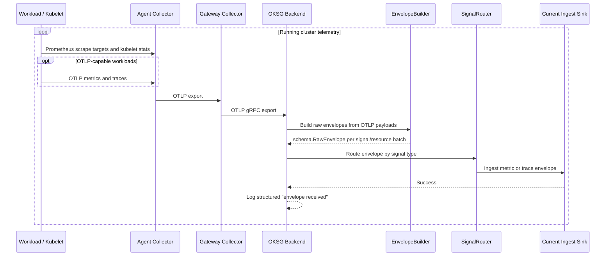

# Runtime Flow

This document describes the currently implemented runtime telemetry flow after the OpenTelemetry collection plane has already been deployed to the cluster.

It complements [`discovery-flow.md`](./discovery-flow.md):

- `discovery-flow.md` explains how OKSG discovers the cluster and deploys the collection plane
- `runtime-flow.md` explains what happens after agent, gateway, and backend are running

## Sequence Diagram



## Runtime Stages

### 1. Agent Collection

The agent collector is the node-local collection entrypoint.

What it does today:

- always collects infrastructure telemetry with `kubeletstats`
- adds `prometheus` scraping when discovery found annotated services
- enables `otlp` receivers when discovery found OTLP-capable sources
- enriches metrics and traces with `k8sattributes`
- batches data before export
- exports to the in-cluster gateway over OTLP gRPC

Operational notes:

- the agent is deployed as a DaemonSet
- startup retries against the gateway are expected if the gateway pod is not ready yet
- the current chart enables the `receiver.kubeletstats.enableCPUUsageMetrics` feature gate to align with the collector's newer kubelet CPU metric behavior

### 2. Gateway Routing

The gateway collector is the shared in-cluster fan-in point.

What it does today:

- receives OTLP over gRPC and HTTP
- accepts exports from the agent
- can also accept OTLP-native application telemetry
- applies `memory_limiter` and `batch`
- exports to the backend OTLP gRPC endpoint
- uses send-queue and retry settings for basic transport resilience

Operational notes:

- the gateway is deployed as a single Deployment replica in the current slice
- its job is collection and forwarding only; it does not perform semantic normalization or persistence

### 3. Backend OTLP Ingest

The OKSG backend is the first OKSG-owned runtime that accepts forwarded telemetry.

What it does today:

- listens for OTLP gRPC on port `4317`
- listens for OTLP HTTP on port `4318`
- serves health checks on port `13133`
- accepts enabled signal classes from the deployed plan
- parses incoming OTLP metrics and traces
- hands accepted payloads to backend ingest components

Operational notes:

- logs are structured JSON to stdout
- the backend currently acts as an ingest boundary, not as a persistence or query layer

### 4. Raw Envelope Build

After the backend receives OTLP payloads, `pkg/backend/ingest` converts them into canonical raw envelopes.

What the envelope builder currently captures:

- signal type such as `metric` or `trace`
- source transport such as `otlp/grpc` or `otlp/http`
- receive timestamp
- resource attributes attached to the OTLP payload
- raw payload bytes for later downstream processing

This is the current canonical handoff from collection into future semantic processing layers.

### 5. Signal Routing

The backend then routes each `schema.RawEnvelope` by signal type.

What is implemented today:

- metric envelopes can be ingested
- trace envelopes can be ingested when the signal is enabled
- routing happens through explicit ingest interfaces in `pkg/backend/ingest`

What the sink does today:

- accepts the routed envelope
- emits structured logs confirming acceptance

This is intentionally minimal so Phase 4 can add normalization and persistence without redesigning the ingest boundary.

## Current Observable Behavior

The easiest way to verify the runtime flow today is with `kubectl logs`.

Expected operator-visible behavior:

- agent logs show receiver startup and scrape discovery
- gateway logs show OTLP receiver startup and successful forwarding behavior
- backend logs show one structured line per accepted raw envelope

Example backend log shape:

```json
{
  "component": "backend",
  "level": "info",
  "msg": "envelope received",
  "signal_type": "metric",
  "source": "otlp/grpc",
  "resource": {
    "service.name": "oksg-demo-gateway-go"
  }
}
```

## Implemented Vs Deferred

Implemented in the current slice:

- agent collection from `kubeletstats`
- conditional Prometheus scraping
- conditional OTLP receive paths
- gateway OTLP fan-in and export
- backend OTLP ingest over gRPC and HTTP
- raw envelope construction
- signal-type routing
- stdout-based verification through structured backend logs

Not implemented yet:

- semantic normalization of raw telemetry into canonical entities or metrics
- topology reconstruction and graph assembly
- durable persistence of telemetry or graph state
- query APIs over stored telemetry or topology
- controller-driven runtime management
- prediction, simulation, or model-ready feature generation

## Runtime View

```text
Workloads / Kubelet
        |
        v
Agent Collector
  - kubeletstats
  - prometheus (when discovered)
  - otlp (when discovered)
        |
        v
Gateway Collector
  - otlp receive
  - memory_limiter
  - batch
        |
        v
OKSG Backend
  - OTLP gRPC/HTTP ingest
  - Raw envelope build
  - Signal routing
  - Structured acceptance logs
```

## Debugging Commands

```bash
kubectl logs -n oksg-system -l app.kubernetes.io/name=oksg-otel,app.kubernetes.io/component=agent --tail=50
kubectl logs -n oksg-system -l app.kubernetes.io/name=oksg-otel,app.kubernetes.io/component=gateway --tail=50
kubectl logs -n oksg-system -l app.kubernetes.io/name=oksg-otel,app.kubernetes.io/component=backend --tail=50
kubectl get pods,svc,endpoints -n oksg-system
```
