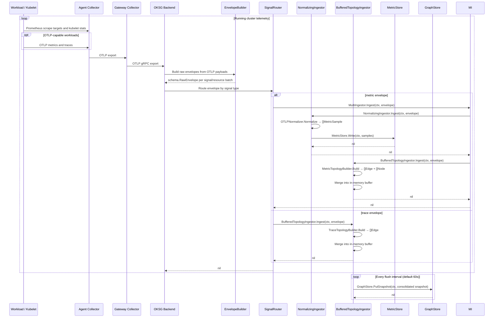

# Runtime Flow

What happens after Helm deploys the OTel collection plane: the backend loads
its mandatory chart-owned source contract, refreshes Kubernetes structure,
then accepts agent and gateway telemetry for generic ingestion, normalization,
and topology accumulation. For the discover/plan/deploy upstream of this, see
[`discovery-flow.md`](./discovery-flow.md). For the metrics catalog /
dialect / source arbitration, see [`metrics-pipeline.md`](./metrics-pipeline.md).

Before this runtime begins, static source modules resolve the source contract
and emit provider-neutral collection requirements. `pkg/collector` composes
those requirements into one deterministic collection plan, and only
`pkg/adapters/otel` translates that plan into OpenTelemetry Collector syntax.
The backend consumes the mounted generic source contract, never OTel planning
types or collector-specific source-selection logic.

## Sequence Diagram



## Backend Ingest Sequence

The following diagram shows how the backend process wires and runs its components, and how a single OTLP request flows through them.

```mermaid
sequenceDiagram
    participant Gateway as Gateway Collector
    participant Main as cmd/backend/main.go
    participant Server as pkg/adapters/otlp/server.go
    participant Builder as EnvelopeBuilder
    participant Router as SignalRouter
    participant NI as NormalizingIngestor
    participant Norm as OTLPNormalizer
    participant MS as MetricStore

    Note over Main: Process startup
    Main->>Main: Load mounted profile + plan; validate exact static contract
    Main->>Main: NewStores(storage configuration)
    Main->>Main: Refresh kubernetes.structure through in-cluster API
    Main->>Main: Build registry dialects + MetricSourcePolicy from mounted plan
    Main->>Main: NewOTLPEntityResolver(clusterName)
    Main->>Main: NewOTLPNormalizer(resolver, dialects, source policy)
    Main->>NI: NewNormalizingIngestor(normalizer, metric store)
    Main->>Main: NewBufferedTopologyIngestor(metric + trace builders, graph store)
    Main->>Router: NewSignalRouter(normalizing and topology ingestors)
    Main->>Builder: ingest.NewEnvelopeBuilder(clock)
    Main->>Server: otlp.NewServer(config, builder, router, logger)
    Main->>Server: server.Run(ctx)
    Note over Server: Listening on :4317 (gRPC), :4318 (HTTP), :13133 (health)

    Note over Gateway,Server: Runtime: OTLP Export Request
    Gateway->>Server: OTLP gRPC Export (metrics)
    activate Server
    Server->>Server: Check enabled["metric"]
    Server->>Builder: BuildMetricEnvelopes("otlp/grpc", request)
    activate Builder
    Builder->>Builder: For each ResourceMetrics: extract resource attributes, marshal payload to JSON
    Builder->>Builder: schema.NewRawEnvelope(source, SignalMetric, attrs, payload, clock())
    Builder-->>Server: []schema.RawEnvelope
    deactivate Builder

    loop For each envelope
        Server->>Router: Route(ctx, envelope)
        activate Router
        Router->>Router: Switch on envelope.SignalType
        Router->>NI: metrics.Ingest(ctx, envelope)
        activate NI
        NI->>Norm: Normalize(ctx, envelope)
        Norm->>Norm: Unmarshal ResourceMetrics, resolve entity, map metrics
        Norm-->>NI: []MetricSample
        NI->>MS: Write(ctx, samples)
        MS-->>NI: nil
        NI-->>Router: nil (success)
        deactivate NI
        Router-->>Server: nil (success)
        deactivate Router
    end

    Server-->>Gateway: ExportMetricsServiceResponse{}
    deactivate Server
```

## Component Responsibilities

| File | Type | Role |
|------|------|------|
| `cmd/backend/main.go` | Binary entrypoint | Loads and strictly validates the mounted source contract, refreshes structure in-cluster, wires generic ingestion, and starts OTLP plus `/api/v1` servers |
| `pkg/adapters/otlp/server.go` | `Server` | OTLP gRPC/HTTP listener, delegates to builder + router |
| `pkg/backend/ingest/otlp.go` | `EnvelopeBuilder` | Converts OTLP protos → `[]schema.RawEnvelope` |
| `pkg/backend/ingest/otlp.go` | `SignalRouter` | Routes envelopes by signal type to the right `Ingestor` |
| `pkg/backend/ingest/entity_resolver.go` | `OTLPEntityResolver` | Maps OTLP resource attributes to canonical `EntityID` (deterministic SHA-256) |
| `pkg/backend/ingest/normalizer.go` | `OTLPNormalizer` | Maps OTLP metric payloads to canonical `MetricSample` values with unit conversion |
| `pkg/backend/ingest/topology_builder.go` | `TraceTopologyBuilder` | Extracts service-to-service `topology.Edge` values from OTLP trace envelopes |
| `pkg/backend/ingest/normalizing_ingestor.go` | `NormalizingIngestor` | Implements `Ingestor`; routes metric envelopes through normalizer → `MetricStore` |
| `pkg/backend/ingest/buffered_topology_ingestor.go` | `BufferedTopologyIngestor` | Implements `Ingestor`; accumulates edges/nodes from metric and trace builders, flushes consolidated snapshots to `GraphStore` on a timer |
| `pkg/backend/ingest/normalizing_ingestor.go` | `MultiIngestor` | Implements `Ingestor`; fans envelopes to multiple downstream ingestors in order |
| `pkg/backend/ingest/metric_topology_builder.go` | `MetricTopologyBuilder` | Extracts structural `runs_on`/`contains` edges and nodes from metric resource attributes |
| `pkg/backend/ingest/metric_calls_topology_builder.go` | `MetricCallsTopologyBuilder` | Validates and derives `calls` edges from metrics classified by their static source module |
| `pkg/backend/ingest/composite_topology_builder.go` | `CompositeTopologyBuilder` | Chains topology builders so the metric path runs structural + metric-calls builders together |
| `pkg/sources/structure` | `kubernetes.structure` | Direct in-cluster refresh of Kubernetes entities and `exposes`/`routes_to`/`uses`/`mounts` edges into GraphStore |
| `pkg/core/metrics/{catalog,dialect,resolver}.go` + `pkg/sources/registry.go` | Metrics pipeline | Canonical catalog, generic dialect/resolver contracts, and the static source-module inventory |
| `pkg/core/semconv/keys.go` | Attribute keys | OTLP semantic-convention attribute key constants shared across ingest and topology |
| `pkg/backend/persistence/memory.go` | `MetricStore` | Thread-safe in-memory `MetricStore`; supports write, time-range queries, and catalog stats |
| `pkg/backend/persistence/memory.go` | `GraphStore` | Thread-safe in-memory `GraphStore`; accumulates edges and nodes, updates `LastSeen` on re-observation |
| `pkg/adapters/storage/victoriametrics/` | `VMMetricStore` | `MetricStore` backed by VictoriaMetrics HTTP API (Prometheus text import + PromQL query) |
| `pkg/adapters/storage/postgresql/` | `PostgresGraphStore` | `GraphStore` backed by PostgreSQL with accumulated edge upserts |
| `pkg/adapters/storage/factory.go` | `Stores` / `NewStores` | Factory that wires memory or external (PG+VM) backends based on config |
| `pkg/backend/ingest/ingest.go` | `Ingestor` interface | Contract: `Ingest(ctx, envelope) error` |
| `pkg/core/schema` | `RawEnvelope` | Canonical telemetry envelope struct |

## Data Flow Summary

```
Gateway
   │
   │ OTLP gRPC/HTTP
   ▼
┌──────────────────────────────────────────────────────────────┐
│  pkg/adapters/otlp/server.go                                 │
│  (metricsService.Export / handleMetricsHTTP)                 │
│                                                              │
│  1. Check signal enabled                                     │
│  2. builder.BuildMetricEnvelopes("otlp/grpc", request)       │
│  3. for each envelope: router.Route(ctx, envelope)           │
└──────────────────────────────────────────────────────────────┘
         │                              │
         │ BuildMetricEnvelopes         │ Route
         ▼                              ▼
┌─────────────────────────┐   ┌─────────────────────────────────────────────────┐
│ EnvelopeBuilder         │   │ SignalRouter                                    │
│ (pkg/backend/ingest)    │   │ (pkg/backend/ingest)                            │
│                         │   │                                                 │
│ → []schema.RawEnvelope  │   │ metric → MultiIngestor                          │
└─────────────────────────┘   │ trace  → BufferedTopologyIngestor               │
                              └─────────────────────────────────────────────────┘
                                        │                          │
                              ┌─────────▼──────────┐   ┌──────────▼──────────────────────────┐
                              │ MultiIngestor      │   │ BufferedTopologyIngestor (shared)   │
                              │                    │   │  metric + trace paths → buffer      │
                              │ ┌─────────────────┐│   │  periodic flush → GraphStore        │
                              │ │NormalizingIngest││   └──────────────────────────────────────┘
                              │ │ OTLPNormalizer  ││                │
                              │ │ → []MetricSample││                ▼
                              │ │ MetricStore     ││   ┌─────────────────────┐
                              │ └─────────────────┘│   │ GraphStore          │
                              │ ┌─────────────────┐│   │ (nodes + edges)     │
                              │ │BufferedTopology ││   │ (pkg/backend/       │
                              │ │Ingestor (shared)││   │  persistence)       │
                              │ │ → []Edge + Node ││   └─────────────────────┘
                              │ │ → in-memory buf ││
                              │ └─────────────────┘│
                              └────────────────────┘
                                        │
                                        ▼
                              ┌─────────────────────┐
                              │ MetricStore         │
                              │ (pkg/backend/       │
                              │  persistence)       │
                              └─────────────────────┘
```

## Runtime Stages

### 1. Agent Collection

The agent collector is the node-local collection entrypoint.

What it does today:

- always collects infrastructure telemetry with the kubeletstats receiver under the `kubelet_stats` component ID
- adds `prometheus` only for the dedicated Istio pod-discovery scrape job when
  discovery selects a complete mesh; a relabel keep rule makes each DaemonSet
  agent scrape only proxies on its own `K8S_NODE_NAME`
- enables `otlp` receivers when discovery found OTLP-capable sources
- enriches metrics and traces with k8sattributes under the `k8s_attributes` component ID
- batches data before export
- exports to the in-cluster gateway over OTLP gRPC

Operational notes:

- the agent is deployed as a DaemonSet
- source-aware POC deployments use discovery-generated Helm values; direct Helm
  installation is unsupported because it can bypass the discovered source plan
- generated values are point-in-time: rerun discovery, plan generation, and
  deployment whenever observed workload mesh membership changes; this POC has
  no automatic reconciliation
- startup retries against the gateway are expected if the gateway pod is not ready yet
- the chart pins Collector Contrib `0.156.0`; the deleted `receiver.kubeletstats.enableCPUUsageMetrics` feature gate is not configured
- kubelet collection enables every node interface but retains the receiver's default pod-interface collection, and requests `k8s.volume.type` metadata without configuring `k8s_api_config` or adding PV/PVC RBAC

### 2. Gateway Routing

The gateway collector is the shared in-cluster fan-in point.

What it does today:

- receives OTLP over gRPC and HTTP
- accepts exports from the agent
- can also accept OTLP-native application telemetry
- scrapes annotated application metrics once through static Service-DNS targets
- collects Kubernetes API-backed container configuration/status, pod phase/status-reason, and node-condition metrics with `k8s_cluster`
- applies `memory_limiter` and `batch`
- exports to the backend OTLP gRPC endpoint
- uses send-queue and retry settings for basic transport resilience

Operational notes:

- the gateway is deployed as a single Deployment replica
- its job is collection and forwarding only; it does not perform semantic normalization or persistence
- generated v0.156 component IDs use `k8s_cluster` and `service_graph`

### 3. Backend OTLP Ingest

The OKSG backend is the OKSG-owned runtime that accepts forwarded telemetry and drives the normalization pipeline.

What it does today:

- listens for OTLP gRPC on port `4317`
- listens for OTLP HTTP on port `4318`
- serves health checks on port `13133`
- serves the REST API on port `8080`
- accepts enabled signal classes from the deployed plan
- parses incoming OTLP metrics and traces
- hands accepted payloads to the normalization pipeline

The `--cluster-name` flag (or `OKSG_CLUSTER_NAME` env var) controls the cluster name used for entity ID computation. It defaults to `default`.

Operational notes:

- logs are structured JSON to stdout
- with `--storage-backend=memory` (default), data survives only for the process lifetime
- with `--storage-backend=external`, data is persisted to PostgreSQL (graph, entities, metadata) and VictoriaMetrics (metrics)

### Metric Normalization Semantics

The backend serves a scalar metrics API, so OTLP metrics are normalized into canonical samples before storage and query:

- Gauge and Sum datapoints are copied as scalar samples, then multiplied by the configured conversion factor. Delta-valued datapoints remain incremental and carry `temporality=delta`; VictoriaMetrics deduplicates exact retry replays, and query construction derives their rates with `sum_over_time()/window_seconds`.
- Histogram datapoints are stored as raw `_sum` / `_count` samples. Delta histograms keep their incremental sum/count values and the same `temporality=delta` label on both series. Datapoints with `count == 0` are skipped. Query-time means match the two branches on every semantic dimension while ignoring only the internal `oksg_unit` storage label: `_sum` is measured in the metric's physical unit while `_count` is necessarily measured in `count`.
- Application Prometheus HTTP metrics are scraped once by the singleton gateway through static Kubernetes Service DNS targets and attach to the canonical Service entity. Discovery requires `prometheus.io/port` to identify a declared Service port. Samples preserve that port, metrics path, namespace, service, and HTTP labels; Kubernetes performs the Service-port to `targetPort` translation.
- Servicegraph-derived metrics preserve `edge_client`, `edge_server`, `edge_client_id`, `edge_server_id`, `failed`, valid `connection_type`, separate `virtual_node`, generic method/status when emitted, distinct `client_http_method` / `server_http_method`, and namespace labels so edge queries can join runtime telemetry back onto topology edges without collapsing request contexts.
- The gateway servicegraph connector flushes metrics every 15 seconds and retains unmatched spans for 30 seconds so independently batched client/server exports can be paired before an edge expires.
- Kubelet network metrics preserve `direction` and `network_interface_name`, keeping receive/transmit and separate node interfaces as distinct raw series.
- Pod-volume metrics normalize resource/datapoint attributes to `volume_name`, `volume_type`, and optional `persistentvolumeclaim_name`. When a volume datapoint carries a resolvable PVC identity, the normalizer stores the sample against the PVC entity. Otherwise it remains pod-scoped and stays distinct by volume name/type.

### Request, Error, and Duration Semantics

The semconv names stay stable across storage and the API, but the semantics still come from the upstream emitters:

- Counter metrics use the catalog-declared default aggregation. Rate-presented counters default to exact one-minute `window_rate`; cumulative counters such as restarts default to `latest`. Callers can select `latest`, `increase`, `window_rate`, or cumulative `active_rate` with a validated `1m..1h` window.
- `http_request_duration_seconds` translates to `http.server.request.duration` and is normalized from seconds to nanoseconds.
- `traces_service_graph_request_server` translates to `servicegraph.request.duration` and is normalized from seconds to nanoseconds.

The default counter query window is 1 minute and can be overridden through the API up to 1 hour. Responses report the normalized effective mode and window.

### 4. Raw Envelope Build

After the backend receives OTLP payloads, `pkg/backend/ingest` converts them into canonical raw envelopes.

What the envelope builder currently captures:

- signal type such as `metric` or `trace`
- source transport such as `otlp/grpc` or `otlp/http`
- receive timestamp
- resource attributes attached to the OTLP payload
- raw payload bytes for later downstream processing

This is the current canonical handoff from collection into future semantic processing layers.

### 5. Signal Routing

The backend routes each `schema.RawEnvelope` by signal type.

What is implemented today:

- metric envelopes are routed to `NormalizingIngestor`
- trace envelopes are routed to `TopologyIngestor` when the signal is enabled
- routing happens through explicit ingest interfaces in `pkg/backend/ingest`

### 6. Semantic Normalization and Persistence

After routing, envelopes are normalized into canonical domain objects.

Metric path:

- `OTLPEntityResolver` maps OTLP resource attributes to a canonical `EntityID` (deterministic SHA-256 of kind + cluster + attributes). Resolution priority: container > pod > node > deployment > statefulset > replicaset > daemonset > namespace > service. Volume metrics with a PVC label use the PVC identity before the generic resource fallback. Entity resolution errors fail the envelope.
- `OTLPNormalizer` first uses the core `metrics.DialectRegistry` for raw-name translation and `OTLPSemconvMetrics` for generic kind/unit metadata. It then dispatches through the selected static source module in `pkg/sources`; each source package owns collector-specific labels, entity attachment, directional variants, and conversions via the narrow `pkg/sources/contract` boundary. The shared normalizer only traverses scalar/histogram datapoints, enforces source assignment, applies planned conversions, marks delta semantics, and emits raw samples. Application Prometheus samples resolve to Service entities from preserved `namespace` / `service` scrape labels. Servicegraph connector and Istio mesh metrics are enriched with stable edge identity and bounded source dimensions. Dotted OTLP labels are normalized to Prometheus-safe names. Pod status-reason integers receive public `value_label` strings at the API boundary. Istio request-duration histograms are converted from milliseconds to nanoseconds, and histograms are stored as `_sum`/`_count`. Unrecognized metric names are silently skipped.
- `MetricStore` stores the resulting samples in memory or VictoriaMetrics. Supports time-range, entity-filtered, edge-filtered, and catalog-stats queries.
- `MetricTopologyBuilder` extracts structural topology from resource attributes (no payload parsing). It derives `runs_on` edges (pod→node), `contains` edges (namespace→pod, pod→container), and the corresponding `topology.Node` values for all resolved entity kinds. Helm deployments require live Pod lifecycle validation: a `runs_on` refresh needs matching `k8s.pod.uid` and `k8s.node.name` from a scheduled Pod. Its public Pod and Node endpoints remain name-based, but the `runs_on` edge identity is versioned by Pod UID and carries `k8s.cluster.name` for lifecycle reconciliation. The backend fail-closes only `runs_on` while its Pod List/Watch state is unavailable; metric ingestion and `contains` topology continue. When Kubernetes reports a `Succeeded` or `Failed` Pod, it synchronously writes one immutable RFC3339 `terminal_deadline` for that exact UID/node assignment before arming local grace or allowing further `runs_on` refreshes. If that first write fails, that terminal UID is immediately fail-closed: its grace-period refreshes are dropped while the original deadline is retried asynchronously, without extension. A same-name replacement is checked by UID before retirement, so an old timer retires only the old assignment. `MetricCallsTopologyBuilder` asks the validated source module whether a metric derives a `calls` edge and for bounded source metadata. It then assembles and deduplicates the generic edge. Istio owns its mesh provenance, protocol, mTLS, principal, response-flag, and HTTP/gRPC metadata. Metric `calls` edges take `FirstSeen`/`LastSeen` from the datapoint timestamp, falling back to the envelope timestamp only when the datapoint has no timestamp.
- `GraphStore` accumulates edges and nodes across snapshots. Re-observed active edges have their `LastSeen` updated; nodes are merged by entity ID. For each UID-versioned `runs_on` edge, storage is the concurrency authority for one-way `active → pending terminal → retired` transitions. The terminal marker uses a conditional upsert that returns either `pending` or `retired`; a delayed retry that observes `retired` cannot re-arm or recreate the old UID. Before accepting metric refreshes after startup, the backend reconciles persisted UID-versioned `runs_on` assignments whose `k8s.cluster.name` equals its configured cluster. It retires non-terminal assignments absent from the authoritative Pod List/Watch snapshot. An unexpired confirmed initial `terminal_deadline` remains latest-active and is returned to the tracker to re-arm the original timer after a restart, including when the same terminal UID remains in the initial List. A retry-only marker is explicitly unconfirmed: if that UID is absent or replaced at restart, reconciliation retires it immediately, intentionally losing the remaining grace instead of risking a stale assignment in the latest graph. Existing deadlines are immutable and are never reset by a restart. At the deadline, latest-graph queries exclude the edge even before the callback completes; retirement then records RFC3339 `retired_at` without changing `first_seen` or advancing `last_seen`. A retired edge remains in the audit-capable `/api/v1/graph/edges`. Direct deletion or replacement retires a non-terminal assignment immediately. If a terminal UID with a confirmed initial marker is deleted or replaced during its 60-second grace, it remains active through the recorded deadline and only that UID is retired then. Retirement persistence, and retries after an initial terminal-marker failure, run asynchronously with retry-until-cancellation and fixed bounded per-attempt backoff. This POC does not materialize historical graph snapshots and does not provide `graph?at=` replay.

Trace path:

- `TraceTopologyBuilder` scans each span for a `peer.service` attribute. When found, it resolves both caller and callee to `EntityID` values and emits a `topology.Edge` with `RelCalls` relation. Edges are deduplicated within the batch by edge ID. `FirstSeen`/`LastSeen` are taken from span timestamps.
- `GraphStore` accumulates edges and nodes; trace-derived `calls` edges accumulate alongside structural edges from the metric path.

### 7. Source-Mismatch Drop

At backend startup, `cmd/backend/main.go` requires the mounted capability profile
and resolved source plan. It verifies the profile fingerprint, the complete
static module inventory, selected available telemetry sources, and the exact
catalog assignment projection without rerunning arbitration. It then constructs
one `MetricSourcePolicy` from that plan and shares it with the normalizer and
mesh topology builder.

Before entity resolution, the shared `MetricSourcePolicy` requires every recognized canonical datapoint to carry a registered `oksg.source` or `oksg_source` and enforces its assigned winner. Invalid datapoints are dropped while valid siblings continue in the acknowledged batch. Atomic missing, unknown, and assignment-mismatch counters are exposed internally to tests. Mesh topology uses the same decision without recording a second rejection, so invalid servicegraph datapoints cannot create edges. See [metrics-pipeline.md](metrics-pipeline.md) for the full contract.

## Runtime View

```text
Workloads / Kubelet
        |
        v
Agent Collector
  - kubeletstats (pod, container, volume)
  - hostmetrics (CPU, memory, disk, network, load, paging, filesystem, connections)
    - agent host networking defaults on with `ClusterFirstWithHostNet`
    - opting out removes the network scraper; it does not substitute pod-network counters
  - prometheus (when discovered)
  - otlp (when discovered)
        |
        v
Gateway Collector
  - otlp receive
  - k8s_cluster (container configuration/status, pod phases, node conditions)
  - servicegraph connector (when OTLP traces present)
  - memory_limiter
  - batch
        |
        v
OKSG Backend
  - OTLP gRPC/HTTP ingest
  - Raw envelope build
  - Signal routing
    ├── metric → MultiIngestor
    │     ├── NormalizingIngestor → OTLPNormalizer → MetricStore
    │     └── BufferedTopologyIngestor (shared) → accumulates edges + nodes
    │           edges: runs_on (pod→node), contains (ns→pod, pod→container)
    │           nodes: namespace, node, pod, container
    └── trace → BufferedTopologyIngestor (shared) → accumulates edges + nodes
          edges: calls (service→service via peer.service attribute)
  - Periodic topology flush (default 60s)
    └── BufferedTopologyIngestor → GraphStore.PutSnapshot(consolidated snapshot)
  - kubernetes.structure refresh (at startup and on a TTL-safe timer)
    └── direct in-cluster Kubernetes API inventory → GraphStore
          edges: exposes (service→workload), routes_to (ingress→service),
                 uses (workload→configmap/secret), mounts (workload→pvc),
                 contains (workload→pod when discovery can resolve ownership)
          nodes: workload, service, ingress, configmap, secret, pvc, pod

REST API Server (:8080) — all list endpoints support cursor-based pagination
  - /api/v1/status         → system_status (nominal/degraded/disconnected), freshness
  - /api/v1/discovery      → MetadataStore → capability profile summary
  - /api/v1/graph          → GraphStore → snapshot + kind/relation counts + available_filters
  - /api/v1/graph/nodes    → GraphStore + EntityRegistry → enriched nodes (name, namespace, status)
  - /api/v1/graph/nodes/id → GraphStore + EntityRegistry → node detail + enriched edges
  - /api/v1/graph/edges    → GraphStore → filtered edge list
  - /api/v1/metrics        → MetricStore → samples with unit from catalog
  - /api/v1/metrics/catalog/stats → MetricStore → per-canonical-metric source counts and last-seen timestamps
  - /api/v1/metrics/series → MetricStore → samples grouped by metric name + catalog metadata
  - /api/v1/entities       → EntityRegistry → filtered entity list
```

## Debugging Commands

```bash
kubectl logs -n oksg-system -l app.kubernetes.io/name=oksg-otel,app.kubernetes.io/component=agent --tail=50
kubectl logs -n oksg-system -l app.kubernetes.io/name=oksg-otel,app.kubernetes.io/component=gateway --tail=50
kubectl logs -n oksg-system -l app.kubernetes.io/name=oksg-otel,app.kubernetes.io/component=backend --tail=50
kubectl get pods,svc,endpoints -n oksg-system
```
