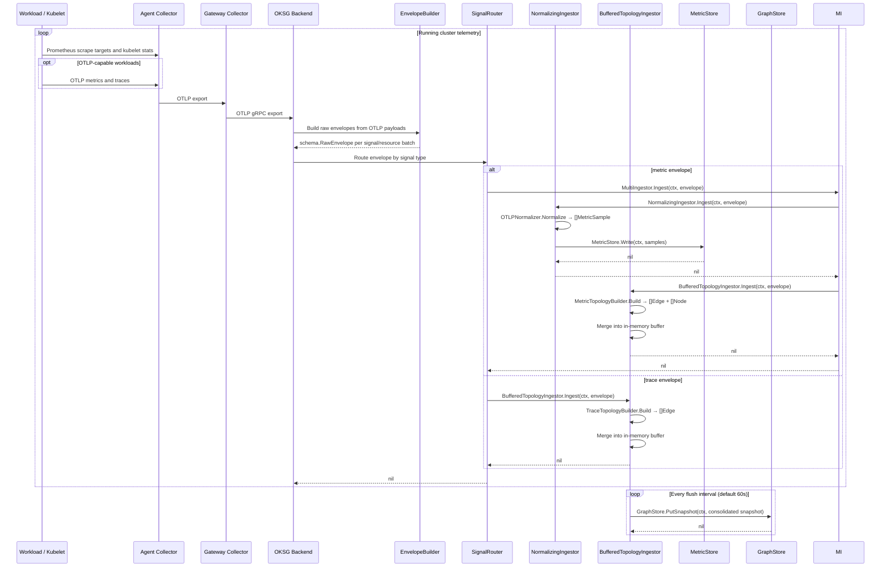
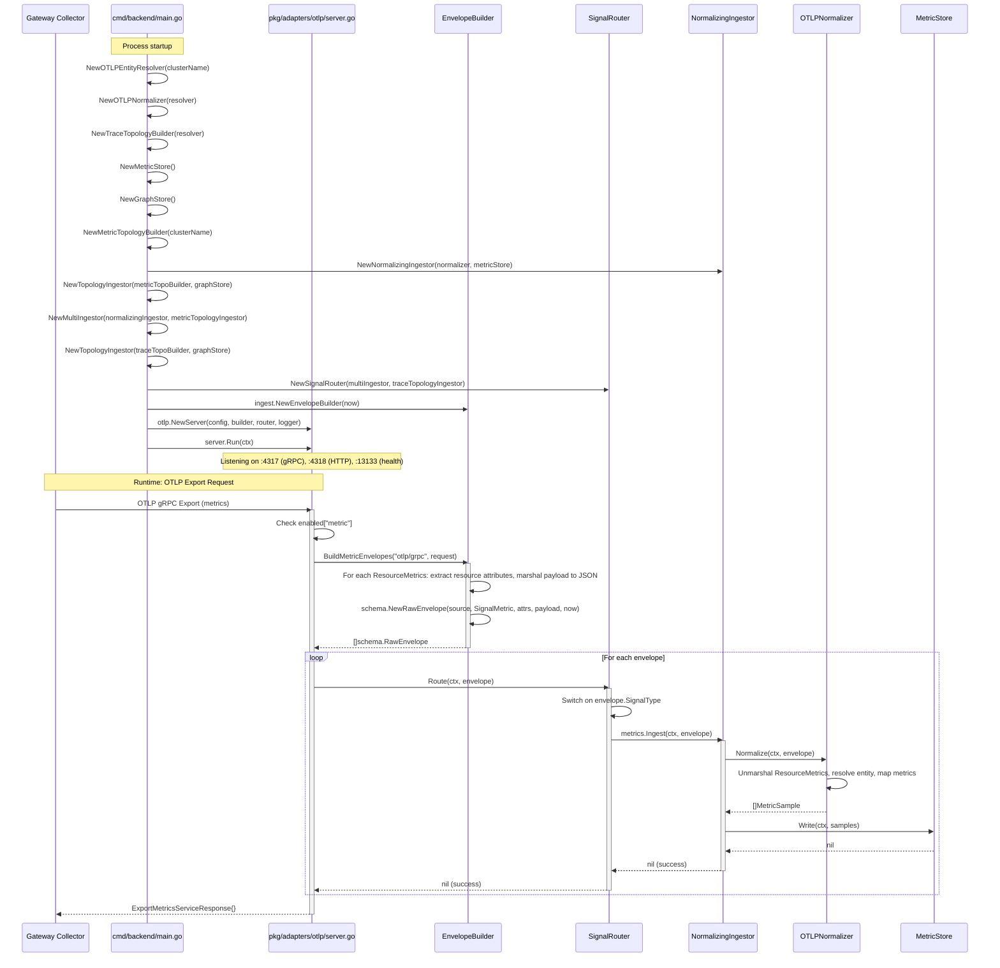

# Runtime Flow

This document describes the currently implemented runtime telemetry flow after the OpenTelemetry collection plane has already been deployed to the cluster.

It complements [`discovery-flow.md`](./discovery-flow.md):

- `discovery-flow.md` explains how OKSG discovers the cluster and deploys the collection plane
- `runtime-flow.md` explains what happens after agent, gateway, and backend are running

## Sequence Diagram



## Backend Ingest Sequence

The following diagram shows how the backend process wires and runs its components, and how a single OTLP request flows through them.



## Component Responsibilities

| File | Type | Role |
|------|------|------|
| `cmd/backend/main.go` | Binary entrypoint | Parses config (including `--cluster-name`), wires normalization pipeline, starts server |
| `pkg/adapters/otlp/server.go` | `Server` | OTLP gRPC/HTTP listener, delegates to builder + router |
| `pkg/backend/ingest/otlp.go` | `EnvelopeBuilder` | Converts OTLP protos → `[]schema.RawEnvelope` |
| `pkg/backend/ingest/otlp.go` | `SignalRouter` | Routes envelopes by signal type to the right `Ingestor` |
| `pkg/backend/ingest/entity_resolver.go` | `OTLPEntityResolver` | Maps OTLP resource attributes to canonical `EntityID` (deterministic SHA-256) |
| `pkg/backend/ingest/normalizer.go` | `OTLPNormalizer` | Maps OTLP metric payloads to canonical `MetricSample` values with unit conversion |
| `pkg/backend/ingest/topology_builder.go` | `TraceTopologyBuilder` | Extracts service-to-service `topology.Edge` values from OTLP trace envelopes |
| `pkg/backend/ingest/normalizing_ingestor.go` | `NormalizingIngestor` | Implements `Ingestor`; routes metric envelopes through normalizer → `MetricStore` |
| `pkg/backend/ingest/buffered_topology_ingestor.go` | `BufferedTopologyIngestor` | Implements `Ingestor`; accumulates edges/nodes from metric and trace builders, flushes consolidated snapshots to `GraphStore` on a timer |
| `pkg/backend/ingest/normalizing_ingestor.go` | `MultiIngestor` | Implements `Ingestor`; fans envelopes to multiple downstream ingestors in order |
| `pkg/backend/ingest/metric_topology_builder.go` | `MetricTopologyBuilder` | Extracts structural `runs_on`/`contains` edges and nodes from metric resource attributes |
| `pkg/backend/ingest/structural_topology_builder.go` | `K8sStructuralTopologyBuilder` | Derives `exposes`/`routes_to`/`uses`/`mounts` edges from ClusterProfile |
| `pkg/backend/ingest/structural_topology_ingestor.go` | `StructuralTopologyIngestor` | Ingests K8s structural topology from ClusterProfile into GraphStore |
| `pkg/backend/persistence/memory.go` | `MetricStore` | Thread-safe in-memory `MetricStore`; supports write and time-range queries |
| `pkg/backend/persistence/memory.go` | `GraphStore` | Thread-safe in-memory `GraphStore`; accumulates edges and nodes, updates `LastSeen` on re-observation |
| `pkg/adapters/storage/victoriametrics/` | `VMMetricStore` | `MetricStore` backed by VictoriaMetrics HTTP API (Prometheus text import + PromQL query) |
| `pkg/adapters/storage/postgresql/` | `PostgresGraphStore` | `GraphStore` backed by PostgreSQL with accumulated edge upserts |
| `pkg/adapters/storage/factory.go` | `Stores` / `NewStores` | Factory that wires memory or external (PG+VM) backends based on config |
| `pkg/backend/ingest/ingest.go` | `Ingestor` interface | Contract: `Ingest(ctx, envelope) error` |
| `pkg/core/schema` | `RawEnvelope` | Canonical telemetry envelope struct |

## Data Flow Summary

```
Gateway
   │
   │ OTLP gRPC/HTTP
   ▼
┌──────────────────────────────────────────────────────────────┐
│  pkg/adapters/otlp/server.go                                 │
│  (metricsService.Export / handleMetricsHTTP)                 │
│                                                              │
│  1. Check signal enabled                                     │
│  2. builder.BuildMetricEnvelopes("otlp/grpc", request)       │
│  3. for each envelope: router.Route(ctx, envelope)           │
└──────────────────────────────────────────────────────────────┘
         │                              │
         │ BuildMetricEnvelopes         │ Route
         ▼                              ▼
┌─────────────────────────┐   ┌─────────────────────────────────────────────────┐
│ EnvelopeBuilder         │   │ SignalRouter                                    │
│ (pkg/backend/ingest)    │   │ (pkg/backend/ingest)                            │
│                         │   │                                                 │
│ → []schema.RawEnvelope  │   │ metric → MultiIngestor                          │
└─────────────────────────┘   │ trace  → BufferedTopologyIngestor               │
                              └─────────────────────────────────────────────────┘
                                        │                          │
                              ┌─────────▼──────────┐   ┌──────────▼──────────────────────────┐
                              │ MultiIngestor      │   │ BufferedTopologyIngestor (shared)   │
                              │                    │   │  metric + trace paths → buffer      │
                              │ ┌─────────────────┐│   │  periodic flush → GraphStore        │
                              │ │NormalizingIngest││   └──────────────────────────────────────┘
                              │ │ OTLPNormalizer  ││                │
                              │ │ → []MetricSample││                ▼
                              │ │ MetricStore     ││   ┌─────────────────────┐
                              │ └─────────────────┘│   │ GraphStore          │
                              │ ┌─────────────────┐│   │ (nodes + edges)     │
                              │ │BufferedTopology ││   │ (pkg/backend/       │
                              │ │Ingestor (shared)││   │  persistence)       │
                              │ │ → []Edge + Node ││   └─────────────────────┘
                              │ │ → in-memory buf ││
                              │ └─────────────────┘│
                              └────────────────────┘
                                        │
                                        ▼
                              ┌─────────────────────┐
                              │ MetricStore         │
                              │ (pkg/backend/       │
                              │  persistence)       │
                              └─────────────────────┘
```

## Runtime Stages

### 1. Agent Collection

The agent collector is the node-local collection entrypoint.

What it does today:

- always collects infrastructure telemetry with `kubeletstats`
- adds `prometheus` scraping when discovery found annotated services
- enables `otlp` receivers when discovery found OTLP-capable sources
- enriches metrics and traces with `k8sattributes`
- batches data before export
- exports to the in-cluster gateway over OTLP gRPC

Operational notes:

- the agent is deployed as a DaemonSet
- startup retries against the gateway are expected if the gateway pod is not ready yet
- the current chart enables the `receiver.kubeletstats.enableCPUUsageMetrics` feature gate to align with the collector's newer kubelet CPU metric behavior

### 2. Gateway Routing

The gateway collector is the shared in-cluster fan-in point.

What it does today:

- receives OTLP over gRPC and HTTP
- accepts exports from the agent
- can also accept OTLP-native application telemetry
- applies `memory_limiter` and `batch`
- exports to the backend OTLP gRPC endpoint
- uses send-queue and retry settings for basic transport resilience

Operational notes:

- the gateway is deployed as a single Deployment replica in the current slice
- its job is collection and forwarding only; it does not perform semantic normalization or persistence

### 3. Backend OTLP Ingest

The OKSG backend is the OKSG-owned runtime that accepts forwarded telemetry and drives the normalization pipeline.

What it does today:

- listens for OTLP gRPC on port `4317`
- listens for OTLP HTTP on port `4318`
- serves health checks on port `13133`
- serves the REST API on port `8080` (Layer 6 Phase A query and control endpoints)
- accepts enabled signal classes from the deployed plan
- parses incoming OTLP metrics and traces
- hands accepted payloads to the normalization pipeline

The `--cluster-name` flag (or `OKSG_CLUSTER_NAME` env var) controls the cluster name used for entity ID computation. It defaults to `default`.

Operational notes:

- logs are structured JSON to stdout
- with `--storage-backend=memory` (default), data survives only for the process lifetime
- with `--storage-backend=external`, data is persisted to PostgreSQL (graph, entities, metadata) and VictoriaMetrics (metrics)

### 4. Raw Envelope Build

After the backend receives OTLP payloads, `pkg/backend/ingest` converts them into canonical raw envelopes.

What the envelope builder currently captures:

- signal type such as `metric` or `trace`
- source transport such as `otlp/grpc` or `otlp/http`
- receive timestamp
- resource attributes attached to the OTLP payload
- raw payload bytes for later downstream processing

This is the current canonical handoff from collection into future semantic processing layers.

### 5. Signal Routing

The backend routes each `schema.RawEnvelope` by signal type.

What is implemented today:

- metric envelopes are routed to `NormalizingIngestor`
- trace envelopes are routed to `TopologyIngestor` when the signal is enabled
- routing happens through explicit ingest interfaces in `pkg/backend/ingest`

### 6. Semantic Normalization and Persistence

After routing, envelopes are normalized into canonical domain objects.

Metric path:

- `OTLPEntityResolver` maps OTLP resource attributes to a canonical `EntityID` (deterministic SHA-256 of kind + cluster + attributes). Resolution priority: container > pod > node > service. Entity resolution errors fail the envelope.
- `OTLPNormalizer` maps each recognized OTLP metric name to a canonical `MetricSample` using the registered `OTLPToCanonicalMappings`. Applies unit conversion. Resolves directional names for disk and network metrics from the `direction` attribute. Unrecognized metric names are silently skipped.
- `MetricStore` stores the resulting samples in memory. Supports time-range and entity-filtered queries.
- `MetricTopologyBuilder` extracts structural topology from resource attributes (no payload parsing). It derives `runs_on` edges (pod→node), `contains` edges (namespace→pod, pod→container), and the corresponding `topology.Node` values for all resolved entity kinds.
- `GraphStore` accumulates edges and nodes across snapshots. Re-observed edges have their `LastSeen` updated; nodes are merged by entity ID.

Trace path:

- `TraceTopologyBuilder` scans each span for a `peer.service` attribute. When found, it resolves both caller and callee to `EntityID` values and emits a `topology.Edge` with `RelCalls` relation. Edges are deduplicated within the batch by edge ID. `FirstSeen`/`LastSeen` are taken from span timestamps.
- `GraphStore` accumulates edges and nodes; trace-derived `calls` edges accumulate alongside structural edges from the metric path.

## Current Observable Behavior

The easiest way to verify the runtime flow today is with `kubectl logs`.

Expected operator-visible behavior:

- agent logs show receiver startup and scrape discovery
- gateway logs show OTLP receiver startup and successful forwarding behavior
- backend logs show startup confirmation of the normalization pipeline configuration
- metric envelopes are normalized to canonical `MetricSample` values and written to the in-memory store
- trace envelopes are processed by `TraceTopologyBuilder`; detected service edges are written to the in-memory graph store

Example backend startup log:

```json
{
  "component": "backend",
  "level": "info",
  "msg": "normalization pipeline configured",
  "cluster_name": "kind-test"
}
```

## Implemented Vs Deferred

Implemented in the current slice:

- agent collection from `kubeletstats`, `hostmetrics`, and `k8scluster`
- conditional Prometheus scraping
- conditional OTLP receive paths
- `spanmetrics` and `servicegraph` connectors when OTLP traces are present
- gateway OTLP fan-in and export
- backend OTLP ingest over gRPC and HTTP
- raw envelope construction
- signal-type routing
- `OTLPEntityResolver`: deterministic entity ID computation from OTLP resource attributes
- `OTLPNormalizer`: canonical metric mapping with unit conversion
- `TraceTopologyBuilder`: service-to-service edge extraction from trace spans
- `NormalizingIngestor` and `TopologyIngestor`: full normalization pipeline
- `MultiIngestor`: fan-out for metric signal path (normalization + structural topology extraction)
- `MetricTopologyBuilder`: structural edges (`runs_on`, `contains`) and nodes from metric resource attributes
- `K8sStructuralTopologyBuilder`: structural edges (`exposes`, `routes_to`, `uses`, `mounts`) from discovery profile
- `StructuralTopologyIngestor`: ingests K8s structural topology from ClusterProfile into GraphStore at startup
- `MetricStore` and `GraphStore`: thread-safe in-memory persistence with node accumulation
- Storage factory (`storage.NewStores`): wires memory or external (PG+VM) backends from config
- PostgreSQL adapter: `GraphStore`, `MetadataStore`, `RawStore`, `EntityRegistry` via `pgx/v5`
- VictoriaMetrics adapter: `MetricStore` via Prometheus text import and PromQL query
- REST API server (Layer 6 Phase A): versioned query endpoints for graph, metrics, entities, and system status on dedicated port 8080

Not implemented yet:

- Layer 6 Phase B: visualization UI
- controller-driven runtime management
- prediction, simulation, or model-ready feature generation

## Runtime View

```text
Workloads / Kubelet
        |
        v
Agent Collector
  - kubeletstats (pod, container, volume)
  - hostmetrics (CPU, memory, disk, network, load)
  - k8scluster (replica counts, pod phases, node conditions)
  - prometheus (when discovered)
  - otlp (when discovered)
  - spanmetrics connector (when OTLP traces present)
  - servicegraph connector (when OTLP traces present)
        |
        v
Gateway Collector
  - otlp receive
  - memory_limiter
  - batch
        |
        v
OKSG Backend
  - OTLP gRPC/HTTP ingest
  - Raw envelope build
  - Signal routing
    ├── metric → MultiIngestor
    │     ├── NormalizingIngestor → OTLPNormalizer → MetricStore
    │     └── BufferedTopologyIngestor (shared) → accumulates edges + nodes
    │           edges: runs_on (pod→node), contains (ns→pod, pod→container)
    │           nodes: namespace, node, pod, container
    └── trace → BufferedTopologyIngestor (shared) → accumulates edges + nodes
          edges: calls (service→service via peer.service attribute)
  - Periodic topology flush (default 60s)
    └── BufferedTopologyIngestor → GraphStore.PutSnapshot(consolidated snapshot)
  - Structural topology (at startup, if --discovery-profile provided)
    └── StructuralTopologyIngestor(K8sStructuralTopologyBuilder) → GraphStore
          edges: exposes (service→workload), routes_to (ingress→service),
                 uses (workload→configmap/secret), mounts (workload→pvc)
          nodes: workload, service, ingress, configmap, secret, pvc

REST API Server (:8080)
  - /api/v1/status      → system status, component availability
  - /api/v1/discovery   → MetadataStore → discovery profile summary
  - /api/v1/graph       → GraphStore → full topology snapshot
  - /api/v1/graph/nodes → GraphStore → filtered node list
  - /api/v1/graph/edges → GraphStore → filtered edge list
  - /api/v1/metrics     → MetricStore → filtered metric samples
  - /api/v1/entities    → EntityRegistry → filtered entity list
```

## Debugging Commands

```bash
kubectl logs -n oksg-system -l app.kubernetes.io/name=oksg-otel,app.kubernetes.io/component=agent --tail=50
kubectl logs -n oksg-system -l app.kubernetes.io/name=oksg-otel,app.kubernetes.io/component=gateway --tail=50
kubectl logs -n oksg-system -l app.kubernetes.io/name=oksg-otel,app.kubernetes.io/component=backend --tail=50
kubectl get pods,svc,endpoints -n oksg-system
```
